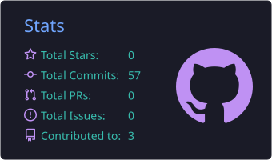
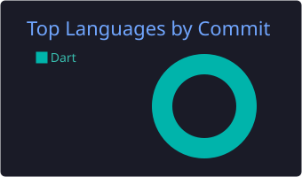

# Hi there, I'm Rafael 👋

I'm a **Full-Stack Developer focused on backend** from Spain.

I build applications and internal tools used every day by real teams, working with **Java**, **.NET / C#**, **Kotlin** and **PHP**, and with relational databases such as **SQL Server**, **MySQL** and **PostgreSQL**.

My experience covers **REST APIs**, **mobile apps**, **web platforms with complex business logic** and **process automation with AI agents** (n8n, LLM integrations).

I enjoy understanding how systems work end to end, from the database to deployment with **Docker** and **Linux**.

---

## 🎯 Currently learning

- **Java & Spring Boot** in depth
- **.NET** and backend best practices
- **Software architecture** and clean code
- **Applied AI**: LLM integration, RAG and agents
- **English**: B1 → working towards B2

---

## 🛠 Tech Stack

  

---

## 📊 GitHub Stats

  
  

---

## 📫 Connect with me

